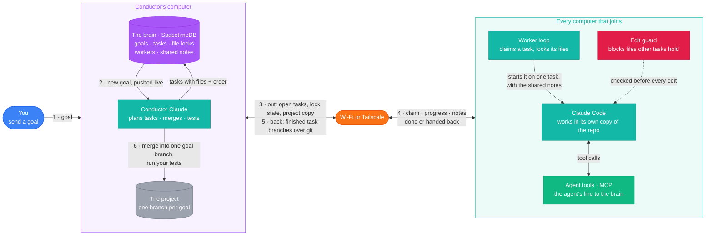
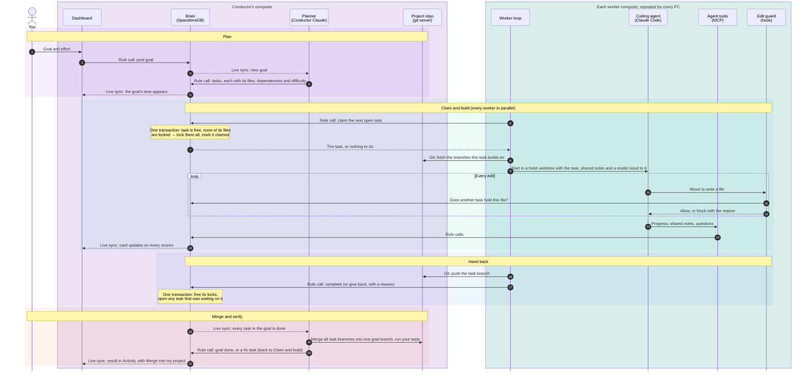
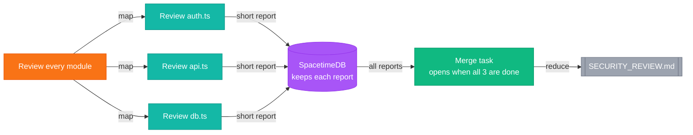

<div align="center">

# Tandem

**Your team's Claude Codes, working as one.**

Give Tandem one outcome. It splits the work across your team's agents, keeps their files from colliding, and returns one tested branch when the goal is finished.

[](https://nodejs.org)
[](docs/ARCHITECTURE.md)
[](https://spacetimedb.com)
[](https://claude.com/claude-code)
[](https://modelcontextprotocol.io)
[](docs/STATUS.md)

[Get started](docs/GETTING_STARTED.md) · [Dashboard tour](docs/DASHBOARD_TOUR.md) · [Help & troubleshooting](docs/HELP.md) · [Architecture](docs/ARCHITECTURE.md) · [Project status](docs/STATUS.md)

</div>

https://github.com/user-attachments/assets/5382ae73-4773-4435-af94-7a36a0ffcc84

## Overview

1. **One prompt for the whole team.** The conductor turns a goal into small tasks, each with the exact files it
   touches and what has to happen first.
2. **Wide goals fan out with map/reduce.** "Write a test for every file" becomes one map task per file across the
   whole team, then a merge task that combines them.
3. **Collisions are impossible, not just discouraged.** Claiming a task locks its files in one database
   transaction, and a Claude Code hook stops an edit to a file another task holds.
4. **Everyone's quota gets used.** Workers on every computer pull tasks themselves, each under its owner's
   Claude login. A worker that runs out hands its task back and another picks it up.

## Purpose

Small engineering teams now give every developer an AI coding agent. Each agent is productive on its own, but
the agents have no awareness of each other. On a shared codebase that creates three recurring costs:

- **Conflicting changes.** Two agents edit the same file for different tasks, and a developer spends time
  reconciling the result instead of shipping.
- **Uneven capacity.** Usage limits are per person. One developer is blocked at their limit while a colleague's
  allowance goes unused, and in-progress work cannot move between them.
- **No shared view of progress.** Work is split up in chat, tracked by memory, and checked by asking.

The problem is sharpest on work that is wide rather than deep. Consider a four-person team that has to move a
40-module service to a new version of an internal API before a deadline. Every module needs the same kind of
change, the changes are independent, and the work would parallelize well across four agents. In practice the team
divides the modules by hand, two agents still touch the shared client file, and someone spends the final day
merging and re-running tests.

Tandem coordinates the team's agents as one system. The goal is stated once and split into tasks with explicit file
ownership, so no two agents edit the same file. Any computer with capacity takes the next task, work that stalls is
handed back automatically, and the team receives a single branch with its tests already run.

## How Tandem differs from running agents side by side

| | Each person runs their own agent | Tandem |
|---|---|---|
| Splitting the work | People divide it up in chat and hope | The conductor plans tasks with file lists and dependencies |
| Repetitive, wide work | One agent grinds through it in sequence | Map/reduce: one piece per worker in parallel, then a merge |
| Two agents, one file | Both edit it and someone resolves the mess | The second agent cannot claim it; a hook blocks the edit |
| Usage limits | That person stops working | The task goes back and another worker takes it |
| A crashed agent | Its half-done work is lost or blocking | Its files are released after two minutes |
| Stuck work | Discovered at the end | Retried by a different worker, then flagged **needs you** with a reason |
| Getting the result | Several branches to merge by hand | One branch per goal, merged and tested, with conflicts turned into fix tasks |
| Seeing progress | Ask around | A live board: who is on what, for how long, their last note, what it cost |
| Accounts | One person's quota | Every teammate's Claude login, and several logins per computer if you like |

## A walk through Tandem

### 1. Bring the team together: Team


The conductor starts Tandem in the project and shares the invite link. Each teammate who joins adds their
computer's Claude Code workers, running under their own login. Worker cards show who is online, which computer each
worker belongs to and what it has finished. The lower part of the page gives the exact next step for adding
another teammate.

### 2. Send a goal and follow it: Board


Type what you want built and choose an effort. Conductor Claude plans it into tasks, and the goal gets its own
lane. Tasks move from **Waiting** (their dependencies are not done yet) to **To do**, **In progress** and **Done**.
Each card names its files and its worker, so you can see at a glance what is running, what is blocked and where
two pieces of work would have met. A task that two workers could not finish is marked **needs you**, with the
reason and **Try again**.

### 3. See what an agent is doing: task details


Open any card to see the worker on it, the files it has locked, the model it runs on, what it depends on, why the
conductor planned it, and its timeline of claims, progress notes and hand-backs.

### 4. Review the result: Activity


Finished goals leave the Board and land here with their tested branch, result, files, workers, duration and cost,
next to **Merge into my project**. Below them is the team's log in plain language: every claim, completion, retry,
merge conflict and test run, filterable by type. When something went wrong, this is where you find out what and
when.

<sub>Shared memory, Usage, Help and the dark theme are in the <a href="docs/DASHBOARD_TOUR.md">dashboard tour</a>.</sub>

---

## Architecture

Tandem has two kinds of computer. The **conductor's computer** holds the shared state, the planner and the project.
**Worker computers** (any number of them, including the conductor's own) do the coding. They are connected over
Wi-Fi or Tailscale, and every message between them goes through one of three channels:



| Channel | Carries | How |
|---|---|---|
| **Rule calls** | Anything that changes shared state: post a goal, claim a task, complete it | A transaction inside the brain; it fully succeeds or changes nothing |
| **Live sync** | Every committed change, out to everyone who cares | Subscriptions: each client keeps a live local copy of the rows it watches |
| **Git** | Code: the project going out, finished task branches coming back | The conductor serves its repository; no GitHub needed |

### How a goal moves through it

The same system step by step. Columns are the parts above, grouped by computer; each arrow is labelled with the
channel it uses.



**Reading the diagram.**

- **Nothing calls anything else directly.** The dashboard, the planner and every worker only talk to the brain, so
  a worker computer can join, crash or leave without anyone else needing to know. Code is the one exception: it
  moves over git, because that is what git is for.
- **Correctness lives in two transactions.** *Claim* (steps 6 to 7) and *complete* (step 17) are where races
  would happen, and both run as single transactions inside the brain. Two workers asking for the same task or the
  same file at the same moment cannot both win, and a task's dependents open exactly once.
- **The edit guard is the second line of defence.** Tasks are planned not to overlap, but an agent can still try to
  touch a file outside its task. The guard checks with the brain before every write and blocks it.
- **Failure re-enters the same loop.** A worker that runs out of quota or gets stuck gives the task back with a
  reason, and it becomes an open task for the next claim. Merge conflicts and failing tests become fix tasks the
  same way. After two failed attempts the task is marked **needs you** instead.
- **Wide goals use the same path.** A map/reduce job is just more tasks: many independent pieces, plus a merge task
  that the brain opens when the last piece completes (see [Map/reduce](#4-mapreduce-for-wide-goals)).

More detail is in [docs/ARCHITECTURE.md](docs/ARCHITECTURE.md).

## Technical highlights

### 1. Why SpacetimeDB

Tandem's hardest requirement is coordination: several agents on several computers must agree, at the same moment,
on who owns which task and which files. A conventional stack would need an API server, a database, a lock service
or queue, and a websocket layer to push updates, plus the glue and failure handling between them. SpacetimeDB
collapses all of that into one component.

| What Tandem needs | Conventional stack | With SpacetimeDB |
|---|---|---|
| Claim a task and lock its files safely | API call → read → check → write, with transactions or retries across a network hop | One reducer call; the rule runs inside the database as a single transaction |
| Tell every screen and worker what changed | A websocket server, or clients polling an endpoint | Clients subscribe to tables and receive each change as it is committed |
| Answer "what is open?" or "who holds this file?" | A query over the network each time | Read from the client's local, live copy of the rows it subscribed to |
| Business rules in one place | Split between API handlers and database constraints | One TypeScript module (`brain/spacetimedb`) published to the database |
| Who is who | A separate auth and session layer | A built-in identity on every connection |

**Where the speed saves time.**

- **Coordination stays out of the critical path.** A Claude Code task runs for minutes. Claiming it, locking its
  files and recording progress are single in-database transactions, so the overhead of coordinating ten agents
  stays a negligible fraction of the time spent coding, and adding agents does not add a server bottleneck.
- **Reads are local.** Each worker and MCP server holds a live replica of the brain, so checking status,
  capacity or open tasks reads memory rather than making a network request.
- **Lock checks are one query.** The lock-check hook runs before every single edit an agent makes. It asks the
  brain one SQL question over HTTP ("does another task hold this file?") instead of going through an API layer,
  so guarding every edit does not slow the agent down noticeably.
- **The board is never stale.** When a task moves on one computer, every other screen updates from the same
  commit. Nobody refreshes, and nobody acts on an out-of-date view of who is working on what.
- **Fewer moving parts, fewer failure modes.** There is no cache to invalidate and no queue to drain or replay.
  The state every part sees is the database's state.
- **It saved build time.** With no backend service to write, deploy or keep in sync with the schema, the time went
  into the coordination rules themselves.

**Measuring it.** We have not benchmarked Tandem yet. The numbers we plan to publish are the time from a claim to
every subscriber seeing it, claim throughput under contention (the 10-client race test, scaled up), and the share
of a goal's wall-clock time spent on coordination versus agent work. Today an idle worker checks for new tasks
every 3 seconds; switching that to a table subscription would make pickup immediate.

### 2. Collisions prevented by the database, not by asking nicely

The `claim_task` reducer checks the task is free, takes every one of its file locks and marks it claimed in one
transaction. SpacetimeDB runs reducers one at a time, so two workers racing for the same task or file can never
both succeed, and a lock conflict leaves no partial locks behind. We test it with 10 clients racing for one task:
exactly one wins.

Locks are also enforced inside Claude Code. A `PreToolUse` hook asks the brain before every edit and blocks any
write to a file another task holds.

### 3. Failure is the normal case

| What happens | What Tandem does |
|---|---|
| A worker hits its usage limit | Hands the task back, waits for the reset, returns |
| A worker is above 80% of its 5-hour quota | Steps down one model (opus → sonnet → haiku) |
| A worker crashes | Its files are released after two minutes |
| A worker cannot finish | Gives the task back with a reason; a different worker tries, with higher effort |
| Two workers cannot finish | The board says **needs you**, why, and offers **Try again** |
| Task branches conflict on merge | The conflict becomes a task a worker fixes |
| Your tests fail on the merged branch | The failure becomes a fix task |

### 4. Map/reduce for wide goals

Some goals are the same small job repeated many times. Take **"Review every module for security problems"**:

- **Map: split it into one piece per item.** The conductor makes one task per module. Each task is small, so
  every free worker on the team can take one at the same time.
- **Each piece hands back a short report.** A worker reviews its module and returns a few lines: which file, how
  serious, what is wrong. The report is saved in SpacetimeDB with the task.
- **Reduce: one final task puts the reports together.** It waits in SpacetimeDB until the last piece is done, then
  opens by itself. Its worker reads every report and writes them into one file, such as `SECURITY_REVIEW.md`.



The many pieces can use a cheap, fast model and the merge a stronger one. Under the hood,
`create_job` creates the pieces and the waiting merge task in one step, and the merge task reads the reports with
`get_job_results`.

### 5. A team in two commands

The conductor runs `tandem --start` in any git repo. Tandem publishes the brain, starts the board, Conductor Claude
and local workers, and serves the project over the network. A teammate runs `tandem join "<invite>"`. Tandem copies
the project into a private work folder and adds that computer's workers, running under the teammate's own login.

---

## Start in three steps

1. Follow the one-time setup in [Getting started](docs/GETTING_STARTED.md).
2. In any Git project with a commit, run:

   ~~~powershell
   tandem --start
   ~~~

3. Send a goal from the Board. Share the printed invite when a teammate is ready to add workers.

The Board is only for active work. Finished goals move to **Activity**, where the result, branch, cost, files and
**Merge into my project** stay together.

| If you want to… | Start here |
|---|---|
| Install Tandem, start a team, join one, or try it safely | [Getting started](docs/GETTING_STARTED.md) |
| See what every dashboard page looks like | [Dashboard tour](docs/DASHBOARD_TOUR.md) |
| Look up commands, options, accounts, or common fixes | [Help & troubleshooting](docs/HELP.md) |
| Understand the locks, workers, model routing, and merge flow | [Architecture](docs/ARCHITECTURE.md) |
| Present the project or check its current evidence and limits | [Demo script](docs/DEMO.md) · [Status](docs/STATUS.md) |
| See future work | [Roadmap](docs/ROADMAP.md) |

## Before you invite people

Tandem is designed for a home network or Tailscale, not the public internet. Everyone uses their own Claude Code
login; Tandem never shares those logins. Read the [network and access details](docs/ARCHITECTURE.md#how-teammates-join)
before opening a team beyond your local computer.

## For developers

```powershell
.\test.ps1          # 12 suites, 478 checks, no Claude calls
.\test.ps1 -Real    # real Claude runs: plan, build with two Claudes, merge, conflicts, a teammate clone
```

- **Atomic rules:** 10 clients race for one task and exactly one wins. Lock conflicts leave no partial locks.
- **Tools:** all 17, through the real MCP protocol, plus an in-memory mock (`BRAIN_MODE=mock`), including
  `create_job` opening its merge task after the last map task.
- **The board:** the whole first-use journey in Chrome, including failures.
- **Failure handling:** a usage limit, a task given back twice, a merge conflict, failing tests.
- **Host sharing:** a second Tandem copies a conductor-served project and pushes a task branch back without GitHub.

| Path | Contents |
|---|---|
| `cli/` | The `tandem` command |
| `brain/` | The SpacetimeDB module: tables and the atomic rules |
| `mcp/` | The MCP server (17 tools from `contract/tools.json`), the worker rules skill, the lock-check hook |
| `manager/` | Conductor Claude: plans each goal, then merges, tests, reviews and finishes it |
| `launcher/` | The worker: claims tasks, runs Claude Code or Codex in a worktree, records cost |
| `dashboard/` | The board (React + Vite) |
| `contract/` | The shared contract: tables, tools, result format |
| `docs/` | Getting started, dashboard tour, help, architecture, status, roadmap, demo script |

Current validation, known limits and real-run notes live in [Status](docs/STATUS.md).

<div align="center">

Built at Cal Hacks 13.0 with [SpacetimeDB](https://spacetimedb.com), the [MCP TypeScript SDK](https://ts.sdk.modelcontextprotocol.io/v2/), [Claude Code](https://claude.com/claude-code), React and Vite.

</div>
