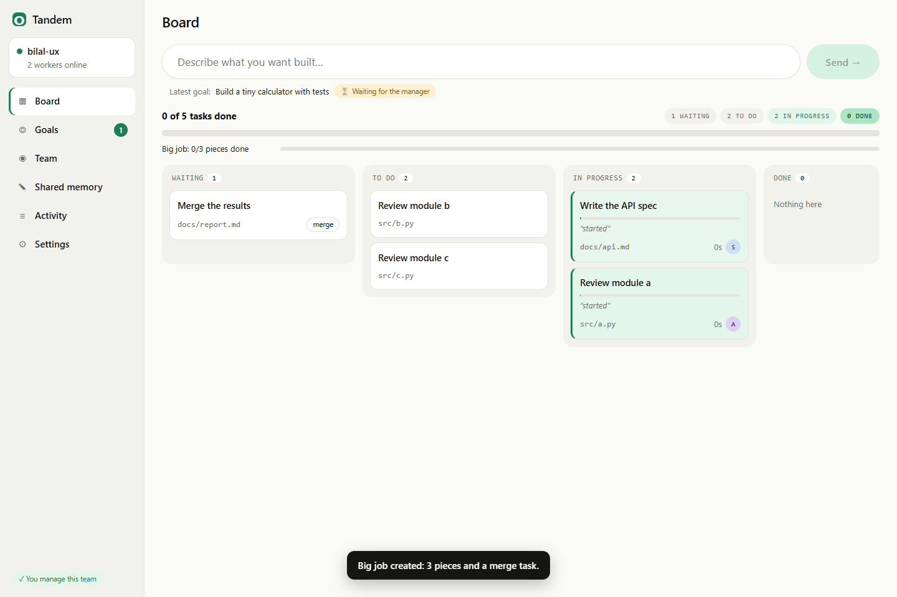
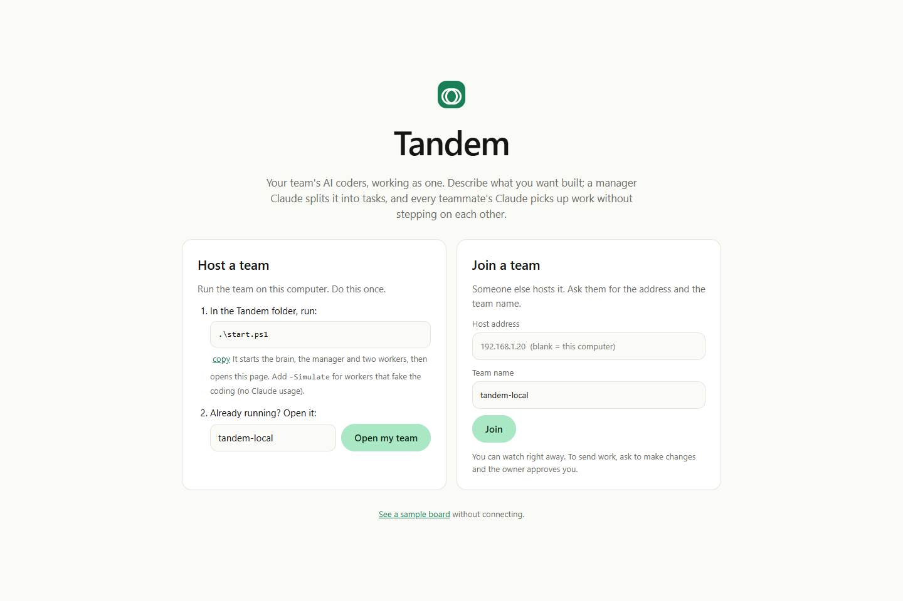
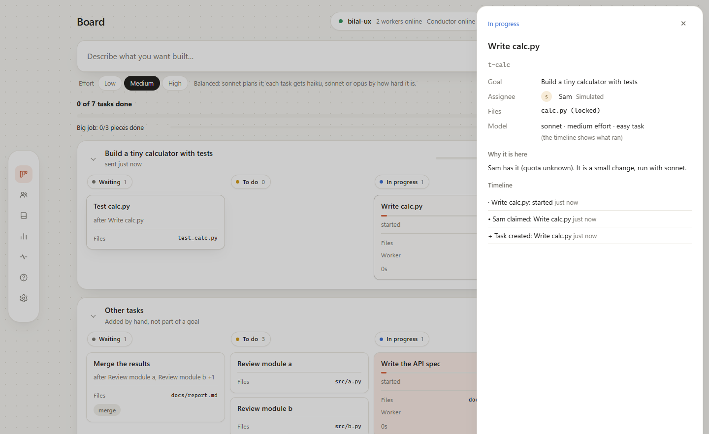

<div align="center">

# Tandem

**Your team's AI coders, working as one.**

Describe what you want built. A manager plans it, every teammate's coding agent picks up work, nobody steps on anyone's files, and you get one tested branch back.




</div>

## The problem
When a few people each run an AI coding agent on the same repo:
1. **They collide.** Two agents edit the same file, duplicate work and drift apart.
2. **Quota is wasted.** One person is out of usage while a teammate's sits idle.
3. **Nobody can see what is going on.**

## What Tandem does
| | |
|---|---|
| **One prompt for the whole team** | Type a goal. The manager turns it into small tasks with the exact files each touches and what has to happen first. |
| **No collisions, guaranteed** | Claiming a task locks its files in one atomic step, so two agents can never get the same task or file. A hook stops a Claude that tries to edit a file someone else holds. |
| **Work goes to whoever has room** | Workers pull tasks themselves. One that hits its usage limit hands its task back, waits for the reset and returns. A crashed one gives its files back after two minutes. |
| **Stuck work comes back to you** | A worker that cannot finish gives the task back with a reason and a different worker tries. If two cannot, the board says **needs you** and why, with **Try again**. |
| **One checked branch per goal** | Finished tasks merge into `tandem/<goal>` and your tests run on it. A merge conflict or failing tests become a task a worker fixes. An optional review runs before it is called done. |
| **Claude and Codex, any accounts** | Each worker can run Claude Code or Codex under its own login. The board shows who runs what. |
| **A live board** | One lane per goal, its tasks moving Waiting → To do → In progress → Done. Who is on what, for how long, their last note, what it cost. |

| Start | A task's details |
|---|---|
|  |  |

## How to start

Two roles. The **host** runs Tandem on a project. A **teammate** adds their computer's Claude workers to the host's team. You can be only the host, only a teammate, or both.

### Before anything (each computer, once)
| You need | Check |
|---|---|
| Node.js **22.18 or newer** | `node --version` (get it at https://nodejs.org) |
| Git | `git --version` |
| Claude Code, signed in | run `claude` once |
| **Host only:** the SpacetimeDB CLI | Windows: `iwr https://windows.spacetimedb.com -useb \| iex`  ·  macOS/Linux: `curl -sSf https://install.spacetimedb.com \| sh` |
| On public wifi: [Tailscale](https://tailscale.com/download), on both computers | see [Public wifi](#public-wifi-use-tailscale) |

### A. Host: start Tandem on your project
**1. Get Tandem (first time only).** In PowerShell or a terminal:
```powershell
git clone https://github.com/Vibertexs/tandem
```
**2. Start it from your project's folder.** Your project is any git repo with at least one commit. Paste this, with your own two paths:
```powershell
# Windows PowerShell
cd C:\path\to\your-project
& "C:\path\to\tandem\tandem.cmd" start
```
```bash
# macOS / Linux
cd /path/to/your-project
/path/to/tandem/tandem start
```
That is the whole setup. There is nothing to install globally and no PATH to edit. It prints something like this and opens the board in your browser:
```
  ✓ brain    started
  ✓ team     "your-project"
  ✓ page     started
  ✓ project  shared from this computer: no GitHub needed
  ✓ manager  started: it plans every goal you type
  ✓ workers  Alex (Claude, haiku)

  Open     http://localhost:5173/?db=your-project
  Invite   http://100.x.y.z:5173/?db=your-project
```
**3. On the board, click Control this team** (it also approves the manager). Then describe what you want built on the **Board** and send it. The manager splits it into tasks, each task runs as a Claude Code run in its own git branch, and when the goal is done the work is merged on one branch, `tandem/<goal>`, with your tests run on it.

The board's **Get started** page repeats these steps with your real folders already filled in, and ticks each one as it happens.

> **Page not loading at `localhost:5173`?** Nothing is running. The board only exists after step 2. Run that command again.

### B. Teammate: add your computer
You need the invite link from the host (the `Invite` line in their terminal, or **Invite** at the top right of their board). Paste this, with that link:
```powershell
# Windows PowerShell
git clone https://github.com/Vibertexs/tandem
cd tandem
.\tandem.cmd join "PASTE-THE-INVITE-LINK-HERE"
```
```bash
# macOS / Linux
git clone https://github.com/Vibertexs/tandem
cd tandem
./tandem join "PASTE-THE-INVITE-LINK-HERE"
```
Keep the quotes around the link. Tandem copies the project from the host (no GitHub needed) into its own work folder and starts your Claude workers. They run under **your** Claude login and quota. Their branches are sent straight back to the host, whose manager merges them. Opening the invite link in a browser also shows the board.

### Who controls the team
- The computer where `tandem start` ran is the **host**.
- A browser that clicked **Control this team** is a **controller**: it can send goals and approve others. It is not an account and not anyone's Claude login.
- Anyone else opening the link is **watching**. They click **Request control**, and a controller approves them.

### Public wifi: use Tailscale
Venue wifi often stops devices reaching each other, and anyone on it could reach an open host. [Tailscale](https://tailscale.com/download) makes a private network between your devices:
1. Everyone installs Tailscale and signs in. The host shares their computer: Tailscale admin, **Machines**, **⋯** next to it, **Share**, and sends the link. Teammates **Accept**.
2. The host starts Tandem as usual. If Tailscale is running, the `Invite` link uses the host's Tailscale address (`100.x.y.z`).
3. Teammates use that invite. If you type an address by hand, use the Tailscale one (`tailscale ip -4`).

The host's project sharing has no login. Share only with people you trust, ideally through Tailscale. `tandem start --local` keeps everything on one computer.

### Several projects at once
Run the start command in each project's folder. Each project is its own team with its own board (`?db=<project folder name>`), all sharing one page. `tandem status` lists them, and `tandem stop` stops all of them.

### If something goes wrong
| You see | Do this |
|---|---|
| `localhost:5173` does not load | Run the host start command again. |
| "Tandem needs Node.js 22.18 or newer" | Install the current LTS from https://nodejs.org, then open a **new** terminal. |
| `tandem` is not recognized | Use the full path as shown above. You never need `tandem` on your PATH. |
| Teammate cannot open the invite | Check Tailscale is connected on both, and the host's share was accepted. |
| "The host is not sharing the project yet" | On the host, `tandem stop`, then start again (not with `--local`). |
| Anything else | `tandem logs` shows the latest lines. |
## Commands
| Command | What it does |
|---|---|
| `tandem start` | Start a team for the Git project you are in, open to your network. The board opens |
| `tandem start --local` | Only this computer can join |
| `tandem start --workers 4` | More workers here (run it again any time; what runs is kept) |
| `tandem start --accounts all` | One worker per saved account (see below) |
| `tandem start --model auto` | Pick the model by task difficulty instead of always haiku |
| `tandem start --review` | A worker reviews each goal's merged branch (read only) before it is done |
| `tandem start --push` | Push each goal's branch to origin, and open a PR if the GitHub CLI is set up |
| `tandem start --notify <url>` | Post "goal done" (branch, tests, cost) to Slack or Discord |
| `tandem join <invite>` | Copy the project host's project into Tandem's private work folder and add this computer's workers |
| `tandem account add <label> [--agent codex]` | A separate Claude Code or Codex login for a worker |
| `tandem` | Show what is running and open the dashboard |
| `tandem -d` | Open the dashboard (also `tandem dashboard`, `tandem open`) |
| `tandem status` | What is running, with each team's links |
| `tandem logs` | Show the latest log lines |
| `tandem --help` | List every command (also `tandem help`, `tandem -h`); `tandem --version` |
| `tandem stop` | Stop what this computer started (`--all` stops the brain too) |

### Several accounts, Claude and Codex
```
tandem account add work1                  # opens Claude Code: /login, sign in, /exit
tandem account add school --agent codex   # opens codex login
tandem start --accounts all               # one worker per account
```
Each account gets its own login folder inside the Tandem folder (`CLAUDE_CONFIG_DIR` for Claude Code, `CODEX_HOME` for Codex), so your own login is not touched. The manager plans with Claude (`--manager-account <label>` picks which). Codex workers run `codex exec` in the task's worktree; Claude Code's lock-check hook has no Codex equivalent, so a Codex worker keeps to its files because the rules tell it to.

## How SpacetimeDB is used
[SpacetimeDB](https://spacetimedb.com) is the **brain**: a database that also runs our rules as code, and pushes every change to every connected client live. It is the one thing all the parts share.

| Role | What it gives Tandem |
|---|---|
| **One shared state** | Goals, tasks, file locks, workers, the activity log and shared memory live in one database. The page, the manager, every worker and every agent's tools read and write the same rows. |
| **Atomic rules (reducers)** | Claim a task, take its file locks and mark it claimed happens as **one transaction**. Two workers racing for a task or a file can never both win. That is what makes collisions impossible, not a convention. We test it with 10 clients at once. |
| **Live updates** | The board never polls. Clients subscribe to tables, and a task moving on one computer moves on every screen immediately. |
| **No server to write** | The rules are a TypeScript module (`brain/spacetimedb`) published to the database. There is no separate backend, queue or cache. |
| **Identities** | Every connection has a saved identity. That is how a worker belongs to the computer that registered it, and how a team controller approves another browser's controller access. |
| **One brain per team** | Each team is one database. `tandem start` publishes it, `tandem join` points other computers at it. |

## How it works
```
 You, in the browser       Manager Claude            A worker on each computer
 "Build a login page"      reads goals, splits       claims a task, runs its agent
                           them into tasks           in a git worktree, completes it
        |                         |                           |
        +-------------------------+---------------------------+
                                  v
          The brain: one shared SpacetimeDB database
          goals · tasks · file locks · workers · activity · shared memory
          claim, lock and complete happen as single atomic steps
```
Nothing talks to anything else directly. Every part reads and writes the brain, and the page updates live from it. More in [docs/ARCHITECTURE.md](docs/ARCHITECTURE.md).

| Folder | What is in it |
|---|---|
| `cli/` | The `tandem` command |
| `brain/` | The SpacetimeDB module (TypeScript): tables and the atomic rules |
| `mcp/` | The MCP server: the 17 tools every agent uses (`contract/tools.json`), the worker rules skill, the lock-check hook |
| `manager/` | Plans each new goal, then merges, tests, reviews and finishes it |
| `launcher/` | The worker: claims tasks, runs Claude Code or Codex in a worktree |
| `dashboard/` | The board (React + Vite) |
| `contract/` | The shared contract: tables, tools, result format |
| `docs/` | Architecture, status, roadmap, demo script |

## Tested
`.\test.ps1` runs **11 suites, 362 checks**, none of which call an AI. [docs/STATUS.md](docs/STATUS.md) has the numbers and [docs/ROADMAP.md](docs/ROADMAP.md) what is next.
- **Atomic rules:** 10 clients race for one task and exactly one wins. Lock conflicts leave no partial locks.
- **Tools:** all 17, through the real MCP protocol, plus a mock mode.
- **The board:** the whole first-use journey in Chrome, on desktop and phone, including failures.
- **Failure handling:** a usage limit, a task given back twice, a merge conflict, failing tests.
- **Host sharing:** a second Tandem state copies a host-served project, then pushes a task branch back to it without GitHub.
- **Real Claude runs** (`.\test.ps1 -Real`): a goal planned, built by two Claudes, merged, tests passing; a Claude blocked from a locked file; a real merge conflict resolved; a teammate on another clone merged through a shared origin.

## Limits
- Tested end to end on Windows. Not yet on a Mac or Linux, or on two physical computers.
- Codex workers are tested with a stand-in, not the real Codex CLI.
- Identities are saved tokens, not accounts. Anyone who can reach the brain can watch it and join as a worker, so keep it on your machine or a private network (such as Tailscale) until it has a real login.
- Hosting is local or on your network. Putting the brain on SpacetimeDB's Maincloud needs `spacetime login`.

<div align="center">

Built with [SpacetimeDB](https://spacetimedb.com), the [MCP TypeScript SDK](https://ts.sdk.modelcontextprotocol.io/v2/), [Claude Code](https://claude.com/claude-code), React and Vite.

</div>
