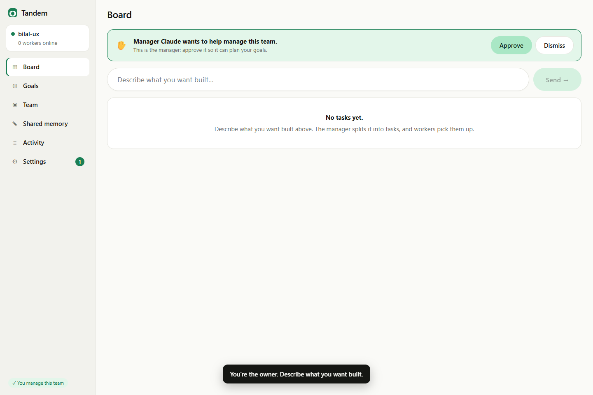

# Tandem

**Your team's AI coders, working as one.** Tell Tandem what you want built. A manager Claude splits it into tasks, every teammate's Claude Code picks up work by itself, and nobody steps on anyone else's files. You watch it all happen on one board.


## The problem
When a few people each run an AI coding agent on the same repo:
1. **They collide.** Two agents edit the same file, duplicate work, and drift apart.
2. **Quota is wasted.** One person is out of Claude usage while a teammate's sits unused.
3. **Nobody can see what's going on.**

## What Tandem does
- **One prompt for the whole team.** Type a goal. The manager Claude turns it into small tasks, with the exact files each one touches and what has to happen first.
- **No collisions, guaranteed.** Claiming a task locks its files in one atomic step, so two agents can never get the same task or the same file. A hook stops a Claude that tries to edit a file someone else holds.
- **Work goes to whoever has room.** Workers pull tasks themselves. A worker that hits its usage limit hands its task back, and a crashed one gives its files back after two minutes.
- **A live board.** Waiting → To do → In progress → Done. You see who is on what, for how long, their latest note, and why each task is where it is.

| Start | Approve the manager | A task's details |
|---|---|---|
|  |  |  |

## Quick start (Windows)
You need [Node.js](https://nodejs.org) 20+, Git, [Claude Code](https://claude.com/claude-code), and the SpacetimeDB CLI. In PowerShell:
```
iwr https://windows.spacetimedb.com -useb | iex
```
Then, in this folder:
```
.\start.ps1 -Simulate
```
That starts everything and opens the page:
- the brain (a local database)
- the page (http://localhost:5173)
- the manager
- two workers

`-Simulate` makes the workers fake the coding, so the demo costs no Claude usage, except one small planning run per goal.

On the page:
1. Click **Make me the owner**.
2. Click **Approve** on "Manager Claude".
3. Describe what you want built, for example *"A tiny Python calculator with add and sub, tests, and a README"*. Watch the board.

For real work, drop `-Simulate`: each task becomes a real headless Claude Code run in its own git worktree and branch. Stop everything with `.\stop.ps1`.

| Command | What it does |
|---|---|
| `.\start.ps1` | Host a team on this computer (brain, page, manager, 2 real workers) |
| `.\start.ps1 -Simulate` | Same, with workers that fake the coding |
| `.\start.ps1 -Lan` | Let other computers on your network join; prints the address |
| `.\start.ps1 -Join ws://<host>:3001 -Db <team>` | Add this computer's workers to someone else's team |
| `.\start.ps1 -Workers 4 -Repo C:\path\to\repo` | More workers, working on your own repo |
| `.\stop.ps1` | Stop what `start.ps1` started (`-All` stops the brain too) |

The page also works on a phone.

## How it works
```
 You, in the browser       Manager Claude            A worker on each computer
 "Build a login page"      reads goals, splits       claims a task, runs Claude Code
                           them into tasks           in a git worktree, completes it
        |                         |                           |
        +-------------------------+---------------------------+
                                  v
          The brain: one shared SpacetimeDB database
          goals · tasks · file locks · workers · activity · shared memory
          claim, lock and complete happen as single atomic steps
```
Nothing talks to anything else directly. Every part reads and writes the brain, and the page updates live from it. The full picture is in [docs/ARCHITECTURE.md](docs/ARCHITECTURE.md).

| Folder | What is in it |
|---|---|
| `brain/` | The SpacetimeDB module (TypeScript): tables and the atomic rules |
| `mcp/` | The MCP server: the 16 tools every Claude uses (`contract/tools.json`), the worker rules skill, the lock-check hook |
| `manager/` | The manager's prompt and the watcher that plans each new goal |
| `launcher/` | The worker: claims tasks, runs `claude -p` in a worktree, routes model and effort by difficulty |
| `dashboard/` | The web page (React) |
| `contract/` | The shared contract: tables, tools, result format |
| `docs/` | Architecture, status, the original spec |

## Tested
Every suite passes on the final commit. See [docs/STATUS.md](docs/STATUS.md) for the latest numbers and commands.
- **Atomic rules:** 10 clients race for one task and exactly one wins. Lock conflicts leave no partial locks. A merge task opens exactly once.
- **MCP tools:** all 16, through the real MCP protocol, plus a mock mode.
- **The page:** the whole first-use journey in Chrome, on desktop and phone.
- **Real Claude runs:**
  - Goal → manager → two workers → done, and the workers' own tests pass.
  - A Claude blocked from editing a locked file.
  - The launcher committing work on its task branch.
  - `start.ps1` from a goal on the page to a full board.

## Limits
- The scripts are PowerShell (Windows). On macOS or Linux, run the same steps by hand (see each folder's README).
- Anyone who can reach the brain can act as any worker. Only managing the team (goals, approvals, clearing) is restricted to approved people.
- Hosting is local or on your network. Putting the brain on SpacetimeDB's hosted Maincloud needs `spacetime login`.

Built with [SpacetimeDB](https://spacetimedb.com), the [MCP TypeScript SDK](https://ts.sdk.modelcontextprotocol.io/v2/), [Claude Code](https://claude.com/claude-code), React and Vite.
