<div align="center">

# Tandem

**Your team's Claude Codes, working as one.**

Type one prompt, and Tandem splits the work across many people's Claude Code agents, with file locks that stop any two of them from editing the same file.<br>
When the work is done, you get one merged branch back with your tests run on it.

[](https://nodejs.org)
[](#project-layout)
[](#why-spacetimedb)
[](https://claude.com/claude-code)
[](contract/tools.json)
[](dashboard/)
[](#testing)
[](#getting-started)
[](#testing)
[](#for-judges)


*The Board. Each goal is a lane; its tasks move from Waiting to Done, and every card shows its files and its worker.*

**Judging for Cal Hacks?** Start with [For judges](#for-judges): what is new, a 3-minute way to see it, and what is real.

</div>

## Contents

- [The problem](#the-problem)
- [What Tandem does](#what-tandem-does)
- [Screenshots](#screenshots)
- [Getting started](#getting-started)
- [Commands and options](#commands-and-options)
- [How it works](#how-it-works): [the big picture](#the-big-picture), [one goal, start to finish](#one-goal-start-to-finish), [a task's life](#a-tasks-life)
- [Why SpacetimeDB](#why-spacetimedb): [inside the brain](#inside-the-brain), [one claim, one transaction](#one-claim-one-transaction), [exactly what is stored](#exactly-what-is-stored), [where code goes](#where-code-goes)
- [Map-reduce, and why per-file ownership works](#map-reduce-and-why-per-file-ownership-works)
- [Shared memory](#shared-memory)
- [Security and networks](#security-and-networks)
- [Testing](#testing)
- [For judges](#for-judges)
- [How it was built](#how-it-was-built)
- [Roadmap](#roadmap)
- [Project layout](#project-layout)

## The problem

When a few people each run an AI coding agent on the same repo:

1. **They collide.** Two agents edit the same file, duplicate work and drift apart on decisions.
2. **Quota is wasted.** One person is out of usage while a teammate's sits idle.
3. **Nobody can see what is going on.** Each agent runs in its own terminal, on its own computer.

## What Tandem does

| Feature | What it does |
|---|---|
| **One prompt for the whole team** | You type a goal. Conductor Claude splits it into small tasks, each with the exact files it touches and what has to finish first. |
| **Effort per goal** | Pick **Low**, **Medium** or **High** when you send a goal. It decides which models plan it and do each task (see [the effort table](#effort-which-model-does-what)). |
| **Collisions are impossible** | Claiming a task and locking its files is one atomic step in the database, so two workers can never win the same task or file. A Claude Code hook also blocks any edit to a file another task holds. |
| **Big jobs as map-reduce** | "Do the same thing for many items" becomes independent pieces that run in parallel on different computers, then one merge task that opens by itself when the last piece finishes. |
| **Usage limits handled** | A worker that hits its plan's limit is capped, its task goes back on the board for someone with headroom, and it comes back by itself after the reset. |
| **Nothing gets stuck** | A crashed worker's files are freed after 2 minutes. A worker that cannot finish gives the task back with a reason; if a second worker cannot either, the board says **needs you**, with **Try again**. |
| **One tested branch** | Finished tasks merge into `tandem/<goal>` and your tests run on it. Failing tests or a merge conflict become a task for a worker. **Merge into my project** puts the result on your branch. |
| **Everything live** | One lane per goal: Waiting, To do, In progress, Done. Who is on what, which model, which files, their last note. Every computer sees a change the moment it happens. |
| **Tokens or dollars** | Every Claude run records its tokens and cost. Show either one; dollars are estimated at API prices (on a Pro or Max plan nothing is billed per run). |
| **The conductor can always take control back** | The conductor's own page carries a key that makes it the one in control, even after a browser lost its saved login. Teammates watch until the conductor approves them. |

## Screenshots

<table>
  <tr>
    <td width="50%" valign="top"><br><b>Task details.</b> Which goal it belongs to, its locked files, the model and effort it runs with, why it went to that worker, and its timeline.</td>
    <td width="50%" valign="top">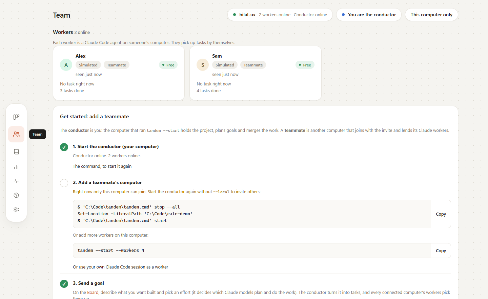<br><b>Team.</b> The workers first, then <b>Get started: add a teammate</b>, with this computer's real commands.</td>
  </tr>
  <tr>
    <td width="50%" valign="top">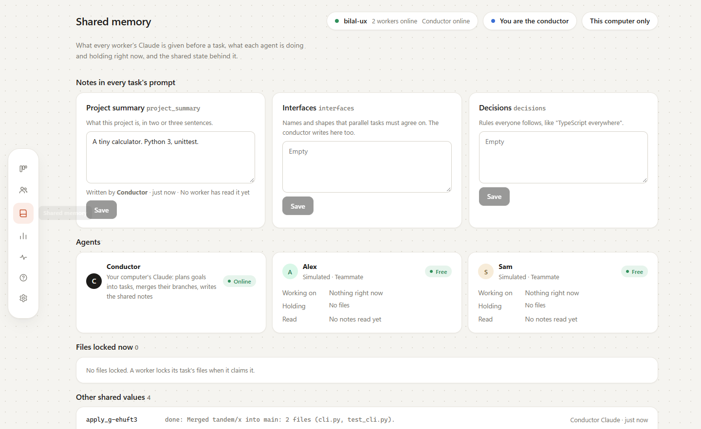<br><b>Shared memory.</b> The notes in every task's prompt, who wrote them, the agents, files locked now and every other shared value.</td>
    <td width="50%" valign="top">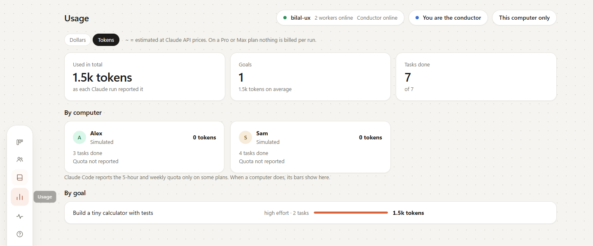<br><b>Usage.</b> Tokens or estimated dollars, per computer and per goal.</td>
  </tr>
</table>

<details>
<summary>More: Help, the dark theme, and the page on a phone</summary>
<br>
<table>
  <tr>
    <td width="40%" valign="top">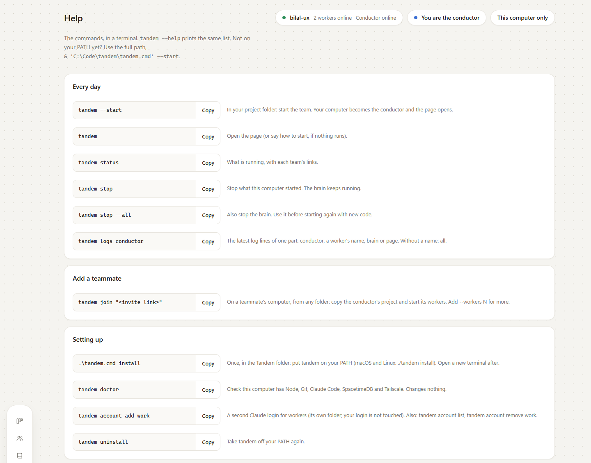<br><b>Help.</b> Every command with a copy button, the start options, and which model each effort uses.</td>
    <td width="40%" valign="top">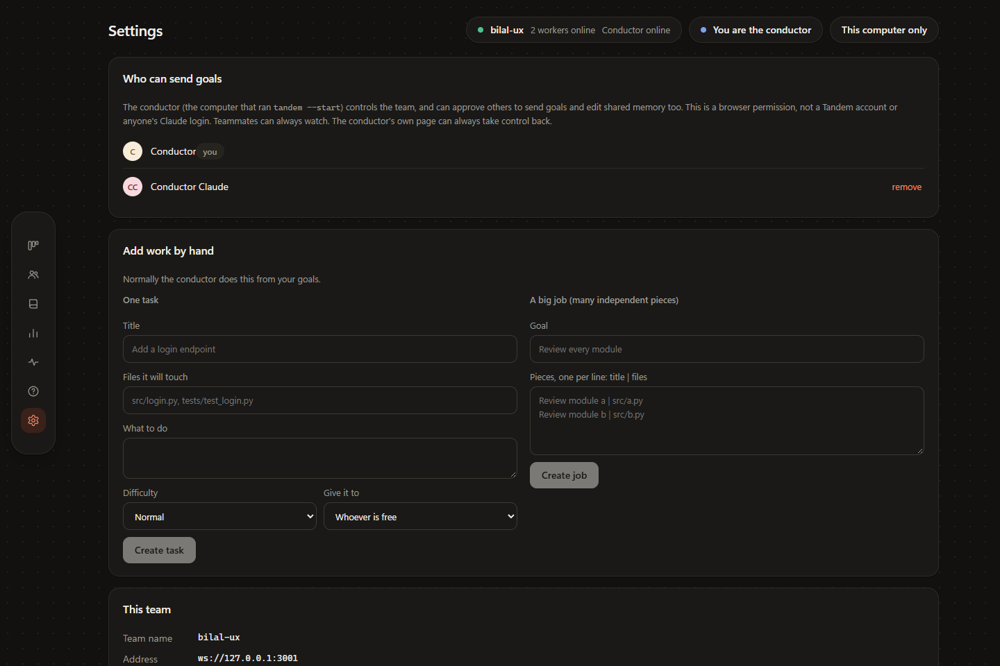<br><b>Dark theme.</b> Settings: who can send goals, and adding work by hand. Theme is System, Light or Dark.</td>
    <td width="20%" valign="top">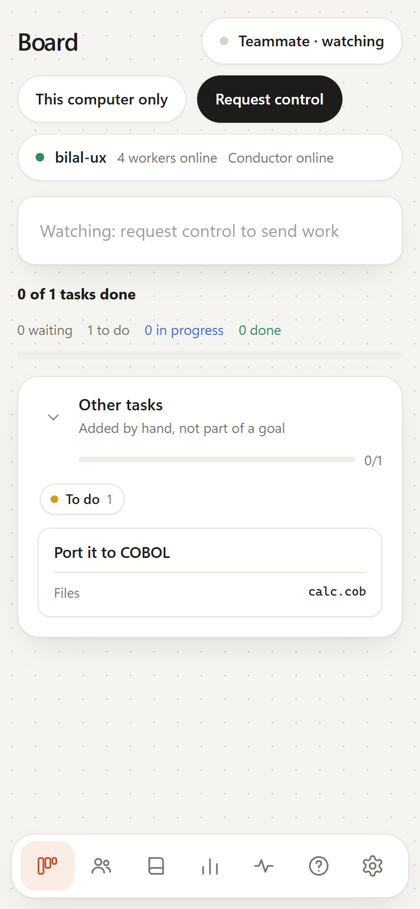<br><b>Phone.</b> A teammate watching, with the dock as a bottom bar.</td>
  </tr>
</table>
</details>

*The screenshots come from the automated page test (`dashboard/test/ui.test.ts`). Its two workers fake the coding, so the page labels them Simulated.*

## Getting started

Windows PowerShell commands first. macOS and Linux are untested: the same steps should work with `./tandem install` and `./tandem --start`.

### Requirements

| You need | Who needs it | Get it |
|---|---|---|
| Node.js 22.18 or newer (with npm) | everyone | [nodejs.org](https://nodejs.org), or on Windows `winget install OpenJS.NodeJS.LTS` |
| Git | everyone | [git-scm.com](https://git-scm.com/downloads) |
| Claude Code, signed in | everyone | [claude.com/claude-code](https://claude.com/claude-code), then run `claude` once and sign in |
| The SpacetimeDB CLI | the conductor | [spacetimedb.com/install](https://spacetimedb.com/install) |
| Tailscale | only teammates on other networks | [tailscale.com/download](https://tailscale.com/download) |

Install the SpacetimeDB CLI on the conductor's computer:

```powershell
# Windows PowerShell
iwr https://windows.spacetimedb.com -useb | iex
```

```bash
# macOS / Linux
curl -sSf https://install.spacetimedb.com | sh
```

### First time only

On each computer, get Tandem and put `tandem` on your PATH (your user only, no administrator needed):

```powershell
git clone https://github.com/Vibertexs/tandem
cd tandem
.\tandem.cmd install
```

Open a **new** terminal (an open one does not see the PATH change), then check the computer. `tandem doctor` lists what Tandem needs, says what to install for anything missing, and changes nothing:

```powershell
tandem doctor
```

The first `tandem --start` or `tandem join` installs Tandem's own packages, which takes a few minutes once. To update Tandem later, run `git pull` in its folder.

### Start as the conductor

In your project's folder (any git repo with at least one commit):

```powershell
cd C:\path\to\your-project
tandem --start
```

It starts the brain, the page, the conductor and one worker, shares the project with your network, and prints something like this:

```text
  ✓ brain    started
  ✓ team     "your-project"
  ✓ page     started
  ✓ project  shared from this computer: no GitHub needed
  ✓ conductor started: it plans every goal you send, with the models its effort picks
  ✓ workers  your-pc (Claude, models by each goal's effort)

  Tandem is running for C:\path\to\your-project

  Open     http://localhost:5173/?db=your-project&...
  Invite   http://100.x.y.z:5173/?db=your-project  (your Tailscale address)
  Stop     tandem stop
```

The page opens, and you are the conductor: there is nothing to click. Type a goal, pick an effort, and press **Send**. Each task runs on its own branch, so your project's folder does not change while the work runs. When the goal is done, press **Merge into my project** on it: Tandem merges `tandem/<goal>` into the branch your project is on. It refuses when you have uncommitted changes, undoes a merge that conflicts, and never forces anything. To look first, `git switch tandem/<goal>`.

### Join as a teammate

After the same first-time step, from any folder, with the invite link from the conductor's page (**Invite**, top right) or terminal. Keep the quotes:

```powershell
tandem join "http://100.x.y.z:5173/?db=your-project"
```

Tandem copies the conductor's project into its own work folder (no GitHub needed) and starts one worker under your Claude Code login (`--workers N` for more). Its task branches go straight back to the conductor's computer, which merges them. Teammates do not need SpacetimeDB.

**On different networks (or venue wifi), use Tailscale.** Everyone installs it and signs in. The conductor shares their computer (Tailscale admin, **Machines**, **...**, **Share**) and teammates accept. `tandem --start` then puts the conductor's Tailscale address (`100.x.y.z`) in the invite.

### Every day

```powershell
tandem                   # open the page
tandem status            # what is running, with each team's links
tandem stop              # stop what this computer started (the brain keeps running)
tandem stop --all        # also stop the brain; use it before starting again with new code
tandem logs conductor    # the latest log lines of one part: conductor, a worker's name, brain or page
```

### Try it in 2 minutes

A throwaway project and a Low-effort goal (haiku, the cheapest model). It uses a few small runs from your Claude plan.

```powershell
mkdir tandem-try
cd tandem-try
git init
git -c user.name=Tandem -c user.email=tandem@localhost commit --allow-empty -m "Start"
tandem --start
```

On the page, pick **Low**, then send:

```text
Create a tiny Python calculator: calc.py with add and sub, test_calc.py with unittest tests, and a README.md.
```

Watch the goal's lane fill up, and click a card to see why it went to that worker and which model it ran. When it is done, the lane shows the merged branch and the test result (the tests need Python). `tandem stop` when you are finished.

<details>
<summary>If something goes wrong</summary>

| You see | Do this |
|---|---|
| `localhost:5173` does not load | Nothing is running. Run `tandem --start` in your project. |
| "Tandem needs Node.js 22.18 or newer" | Install the current LTS from [nodejs.org](https://nodejs.org), then open a new terminal. |
| `tandem` is not recognized | Open a new terminal after `tandem install`, or run it by path: `& 'C:\path\to\tandem\tandem.cmd' --start`. |
| "... is not a git repository" or "has no commits yet" | Run `tandem --start` in your project, and make a first commit. |
| `tandem join` says it cannot reach the conductor | Check both computers are on the same network or on Tailscale, and that the conductor did not use `--local`. |
| "The conductor is not sharing the project yet" | On the conductor's computer: `tandem stop`, then `tandem --start` (not `--local`). |
| "Could not set up the team" after updating Tandem | `tandem --start --fresh` (this wipes the team's board, not your project). |
| Anything else | `tandem doctor`, then `tandem logs`. |

</details>

## Commands and options

Every command works as a word or a flag: `tandem start` is `tandem --start`. `tandem --help` prints this list, and the page's **Help** tab shows the same commands with copy buttons.

| Command | What it does |
|---|---|
| `tandem start` | Start a team for the git repo you are in. You are its conductor: you send the goals, and your computer plans them and merges the work. Prints the invite. |
| `tandem join "<invite>"` | Join as a teammate: copy the conductor's project and add this computer's workers. The invite looks like `http://192.168.1.20:5173/?db=shop`. |
| `tandem` | On its own: opens the page. It shows what is running, or how to get started. |
| `tandem -d` | Open the page (also `tandem dashboard`, `tandem open`, `tandem --dashboard`). |
| `tandem status` | What is running, with each team's links. |
| `tandem logs [part]` | The latest log lines: all, or one part (conductor, a worker's name, brain, page). |
| `tandem stop` | Stop what this computer started (the brain keeps running). |
| `tandem stop --all` | Also stop the brain. |
| `tandem account add <label> [--agent codex]` | A login for workers (opens that CLI to sign in). Each account gets its own login folder in the Tandem folder; your own login is not touched. |
| `tandem account list` | The saved accounts, and whether each is signed in. |
| `tandem account remove <label>` | Remove an account and its login folder. |
| `tandem install` | Put `tandem` on your PATH, so it works in any new terminal (once). |
| `tandem uninstall` | Take it off again. |
| `tandem doctor` | Check this computer has what Tandem needs (Node, Git, Claude Code, SpacetimeDB, Tailscale) and say what to install. Changes nothing. |
| `tandem --version` | Which version this is. |
| `tandem --help` | The list of commands (also `tandem help`, `tandem -h`). |

**Options for `tandem start`**

| Option | What it does |
|---|---|
| `--workers N` | Workers on this computer (default 1, one Claude per person; 0 = none). |
| `--local` | Only this computer can join (default: your network can). |
| `--team NAME` | The team's name (default: this folder's name). |
| `--fresh` | Start the team over: wipes its board (goals, tasks, shared memory, activity). Your project and its branches are not touched. Joined teammates run `join` again. |
| `--push` | Push task and goal branches to origin (a PR per goal with the GitHub CLI). |
| `--review` | A worker reviews each goal before it is done. |
| `--model NAME` | Force one model for every task. Default: each goal's effort and each task's difficulty choose it. |
| `--conductor-model NAME` | Force the model the conductor plans with (default: by the goal's effort: low haiku, medium sonnet, high opus). |
| `--notify URL` | Post "goal done" to a Slack or Discord webhook. |
| `--accounts all\|a,b` | One worker per saved account (see `tandem account`), instead of `--workers`. |
| `--conductor-account A` | The Claude account the conductor plans with. |
| `--no-browser` | Do not open the page. |

`tandem join` takes `--workers N` and `--accounts` as above, and `--repo <path>` to use your own clone of the project instead of the one Tandem makes.

<details>
<summary>Several Claude accounts, and Codex (experimental)</summary>
<br>

By default a worker uses your own Claude Code login. To run workers under other logins (a work and a personal account, say):

```powershell
tandem account add work1
tandem account add personal
tandem --start --accounts all
```

`tandem account add` opens Claude Code: type `/login`, sign in with that account, then `/exit`. Each account's login lives in its own folder inside the Tandem folder (`CLAUDE_CONFIG_DIR`), so your own login is not touched. Workers are named after the computer and the account, for example `bilal-pc-work1`.

`tandem account add school --agent codex` adds a Codex login, and a worker on it runs `codex exec`. Nothing uses Codex unless you add such an account. It has only been tested with a stand-in, never the real Codex CLI, and the lock-check hook is a Claude Code hook, so a Codex worker keeps to its files only because its instructions tell it to.

</details>

## How it works

The diagrams below go from the whole system down to a single transaction: [the big picture](#the-big-picture), [one goal from start to finish](#one-goal-start-to-finish) and [a task's life](#a-tasks-life) here; [inside the brain](#inside-the-brain), [one claim](#one-claim-one-transaction) and [where code goes](#where-code-goes) under Why SpacetimeDB; and [a big job](#map-reduce-and-why-per-file-ownership-works) under Map-reduce. More detail is in [docs/ARCHITECTURE.md](docs/ARCHITECTURE.md).

### The big picture

There are two kinds of traffic, and nothing talks to anything else directly. Coordination (solid lines) goes through the brain: goals, tasks, file locks, progress and the live board. Code (the dotted line) goes through git: a teammate's computer clones the conductor's project and pushes its task branches back. The brain runs on the conductor's computer, and teammates reach it and the project over the home network or Tailscale.

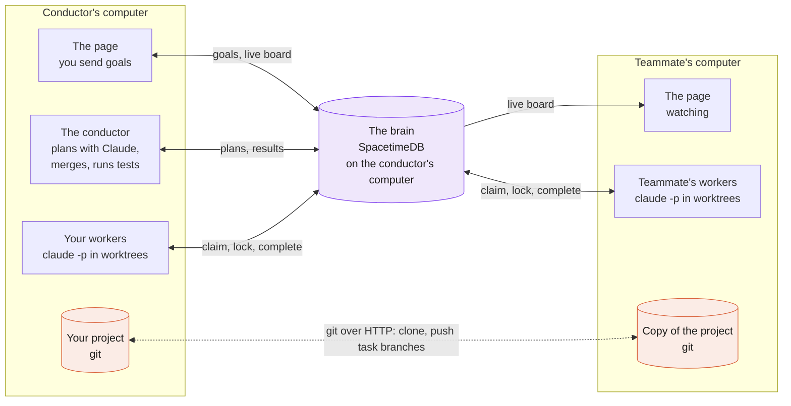

### One goal, start to finish

1. **You send a goal** on the page, with an effort. It is saved in the brain as a new goal.
2. **Conductor Claude plans it.** A headless Claude, its model picked by the effort, reads the goal and the repo (it never edits code), writes a shared note when parallel tasks must agree on something, and creates 2 to 6 tasks, each with its exact files, a difficulty and what it depends on.
3. **Workers claim and lock.** Each worker asks the brain for a task. In one transaction the brain picks an open task whose files are all free, locks them, and writes the worker's name on it.
4. **Each task runs in its own git worktree.** The launcher gives Claude the shared notes, runs `claude -p` with the routed model and effort, commits the work on a task branch, and completes the task. A teammate's worker pushes its branch back to the conductor's project. Tasks that were waiting on it open by themselves, and start with its work merged in.
5. **The conductor merges and checks.** When every task of a goal is done, the conductor merges their branches into `tandem/<goal>` and runs the project's tests (`npm test`, or Python `unittest`). Failing tests add one "Fix the failing tests" task; a merge conflict adds a "Resolve the merge conflict" task. Then the lane shows the result, and **Merge into my project** brings it into your branch.

The same goal as messages between the parts. Solid arrows are calls. Dashed arrows are the brain pushing a change through a subscription: a reducer returns no data, so even the caller sees its result this way (message 6 is how a worker learns which task it won).

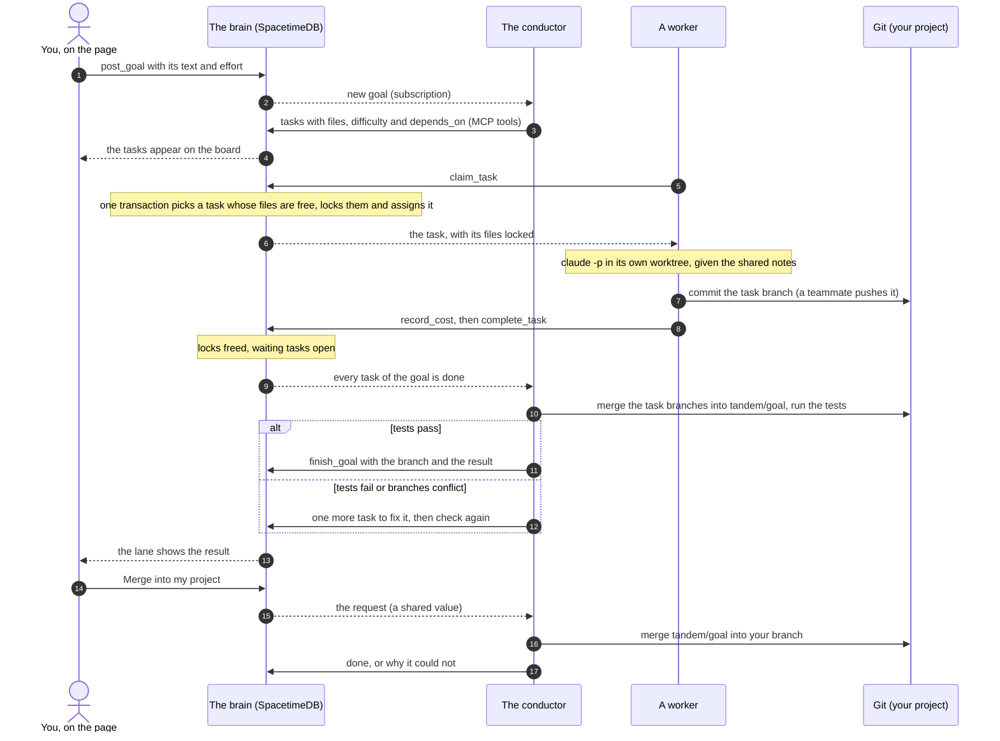

### A task's life

Every task is in one of five states. The board's columns are the first four: Waiting, To do, In progress and Done. A task that two workers gave back says **needs you**, with the reason and **Try again**.

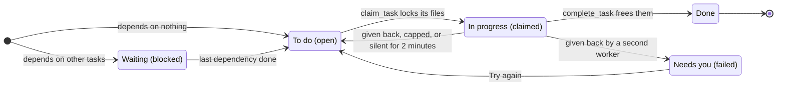

<details>
<summary>When things go wrong</summary>
<br>

- **Two workers claim at once:** the brain handles one first. The other gets a different task or nothing.
- **A file is already locked:** the task waits until the lock is freed. A Claude that tries to edit it anyway is blocked by the hook.
- **A worker crashes:** with no heartbeat for 2 minutes, the brain frees its locks and reopens its task.
- **A worker hits its usage limit:** it is capped and its running task goes back to the queue. The launcher reads when the limit resets from Claude's message (or waits 30 minutes), then takes work again. The page says "Out of quota until 3:00 PM".
- **A worker cannot finish a task:** it gives it back with a reason (the launcher does this after two failed runs). A different worker gets it. If a second worker gives it back too, the page says **needs you** with the reason, and **Try again** puts it back.
- **Two task branches conflict:** the conductor adds a "Resolve the merge conflict" task. The launcher starts that merge in the worker's worktree, Claude removes the conflict markers, and the launcher commits the merge.
- **The tests fail on the goal branch:** the conductor adds one "Fix the failing tests" task and checks again when it is done.
- **With `--review`:** before the goal is done, a worker reviews the merged branch with read-only tools, and its findings go into the goal's note and the PR.

</details>

### The parts

- **`brain/`**: the SpacetimeDB module (TypeScript). The tables, and the rules (reducers) that make claiming and locking atomic.
- **`mcp/`**: the MCP server with the [17 tools](contract/tools.json) every Claude uses, the worker rules skill, and the lock-check hook.
- **`manager/`**: the conductor (the folder keeps its old name). It waits for goals, runs the planning Claude, then merges, tests, reviews and finishes each goal, and applies **Merge into my project**.
- **`launcher/`**: the worker on each computer. It claims a task, picks the model from [`routing.json`](launcher/routing.json), runs Claude Code in a worktree, commits, and records cost and tokens.
- **`dashboard/`**: the page (React + Vite), subscribed live to the brain.
- **`cli/`**: the `tandem` command, and the small server that shares the project over git's HTTP backend.

## Why SpacetimeDB

The brain is a [SpacetimeDB](https://spacetimedb.com) database: a database that runs the project's rules as code and pushes every change to every connected client.

- **Atomic by construction.** Reducers run as transactions inside the database, one at a time, so "claim a task and lock its files" is one step: two workers can never win the same task or the same file. There is no separate server and no lock service. [One claim, one transaction](#one-claim-one-transaction) shows the whole step.
- **Live without polling.** Subscriptions push every row change to every page and worker the moment it happens. Nothing polls. That is why the board moves at the same moment on every computer.
- **TypeScript, like the rest.** The module ([`brain/spacetimedb/src/index.ts`](brain/spacetimedb/src/index.ts)) is TypeScript, as are the MCP server, the conductor, the launcher, the page and the CLI.
- **Identities.** Every connection has a saved identity. A worker belongs to the identity that registered it, and only operators may send goals or write shared notes.

### Inside the brain

Every change is a reducer call. The reducer runs as one transaction against the tables, all or nothing, and the change goes out through subscriptions to every client watching those rows. The same client is usually on both sides: the page calls `post_goal`, then sees the goal arrive like every other page does. The one reader outside this loop is the lock-check hook, which reads the `locks` table with a SQL query over HTTP before each edit.

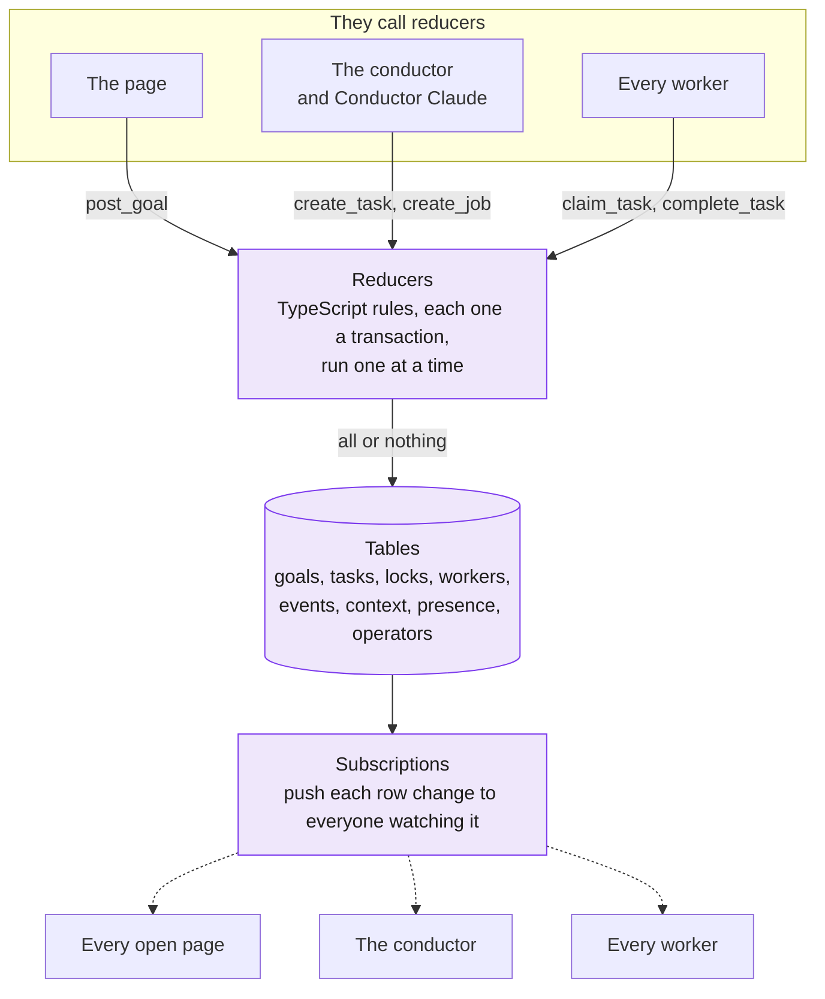

`tandem --start` publishes the module as one database per team. Goals, tasks, locks, workers, events and notes each carry a `session_id`: the team uses `live`, and the tests use their own sessions.

### One claim, one transaction

This is all of `claim_task`, and it runs inside one reducer. SpacetimeDB runs reducers one at a time, so another worker's claim runs completely before or after it, never in the middle. A lock's key is its file path, so the database itself refuses a second holder of a file. Candidates come in order: tasks reserved for this worker first, then open tasks, never one it gave back. Before any of this, the reducer marks the caller alive and reopens the tasks of workers silent for 2 minutes, which is how a crashed worker's files come back. The brain test races ten workers for one task, and exactly one wins.

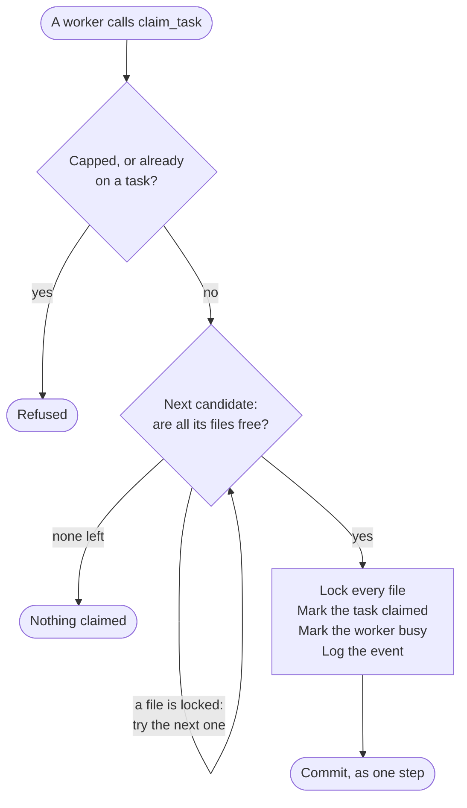

### Exactly what is stored

| Table | What it holds |
|---|---|
| `goals` | What you asked for: the text, its effort, its status, the `tandem/<goal>` branch and a note when done, and what planning it cost (dollars and tokens). |
| `tasks` | Each task: title, description, its files, difficulty, kind (normal, map or merge), model and effort, status, what it depends on, the assignee, its branch, its result, its cost and tokens, and who gave it back. |
| `locks` | Which file, which task holds it, which worker, and since when. |
| `workers` | Each worker: its name (from the computer), the agent and account it runs, its status, its quota (5-hour and weekly, when reported), when it was last seen, and who owns it. |
| `events` | The activity log in plain words, including which worker read which notes before which task. |
| `context` | The shared notes every Claude reads before a task (with who wrote each and when), plus facts such as the project's git address, the project folder and the answers to **Merge into my project**. |
| `presence` | Who is online (the conductor pings it). |
| `operators`, `operator_requests` | Who may send goals, and who is asking to. |
| `host_keys` | Private (no client can read it): the conductor's key for taking control back. |

### Where code goes

**What is never stored: code.** Code moves through git. Each task gets its own worktree and its own branch (`task/<task words>`), so parallel Claudes never share a checkout. Workers on the conductor's computer make their worktrees from the project itself. A teammate's computer clones the project from the conductor, which `tandem --start` serves with git's own HTTP backend (`git http-backend`), and pushes its task branches back the same way. No GitHub is needed. The conductor merges a goal's task branches into `tandem/<goal>` in a separate worktree and runs the tests there, so your branch changes only when you press **Merge into my project**.

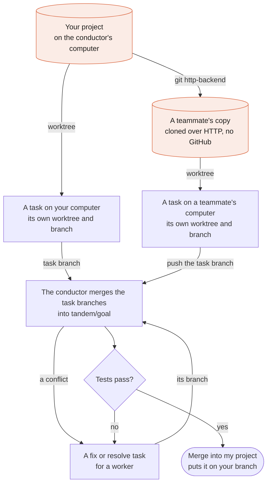

## Map-reduce, and why per-file ownership works

For "do the same thing for many independent items" (review every module, write a test per file), the conductor calls `create_job`. It creates many **map** pieces, each owning its own files, and one **merge** task (`kind = reduce`) that waits on all of them from the start. The pieces run in parallel on whichever computers have free workers. Each returns a small fixed-format result ([`contract/result-format.json`](contract/result-format.json)). When the last piece completes, the same reducer that marks it done opens the merge task, in the same atomic step, so it opens exactly once. The merge task reads the pieces' results with `get_job_results` and combines them.

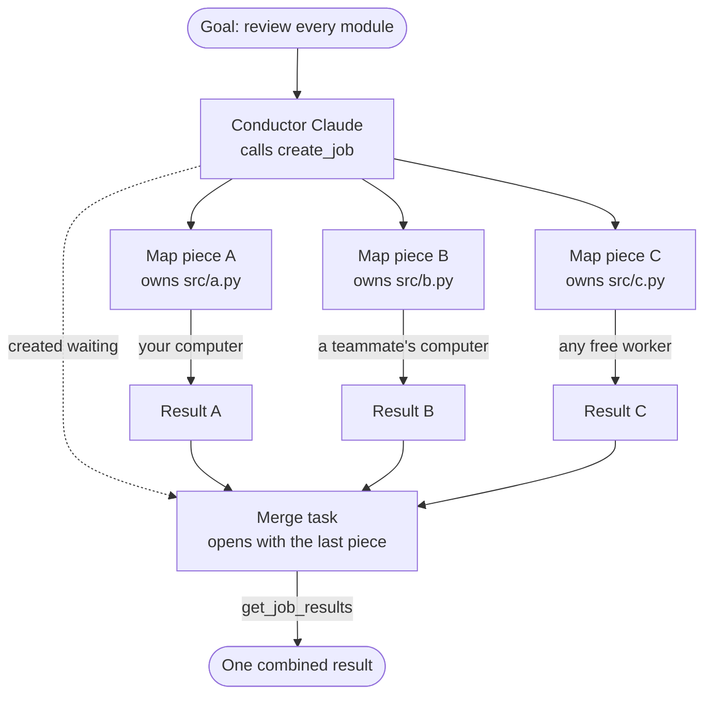

Ordinary goals use the same idea with `depends_on`: tests wait for the code they test, and open by themselves when it is done.

**Why per-file locks are enough.** The conductor splits work along file boundaries: its instructions say never to give two tasks the same file unless one depends on the other. So two parallel tasks never own the same file, nobody ever waits on a half-edited file, and there is no need for finer locks or for merging edits live. If the plan gets it wrong anyway, the brain still refuses to start a task whose files are locked; it waits. When branches still overlap at merge time (a file nobody declared, say), the conflict becomes a "Resolve the merge conflict" task for a worker instead of a broken branch.

### Effort: which model does what

The goal's effort picks every model, from [`launcher/routing.json`](launcher/routing.json). The conductor rates each task easy, normal or hard; map pieces and the merge have their own rows. "medium", "high" and "xhigh" are Claude Code's `--effort`.

| | Low | Medium | High |
|---|---|---|---|
| Plans the goal | haiku | sonnet, medium | opus, high |
| Easy task | haiku | haiku | sonnet, medium |
| Normal task | haiku | sonnet | opus, medium |
| Hard task | sonnet, medium | opus, high | opus, xhigh |
| Map piece | haiku | sonnet | opus, medium |
| Merge (reduce) | sonnet, medium | opus, high | opus, xhigh |

Near a usage limit (a worker reporting more than 80% of its 5-hour quota) a worker steps down one model: opus, then sonnet, then haiku. A task run again after a failure gets at least `high` effort. When several goals wait, the conductor plans them together at the highest of their efforts.

## Shared memory

Three notes go into every worker's prompt before every task:

| Note | Key | What it holds |
|---|---|---|
| Project summary | `project_summary` | What the project is, in two or three sentences. |
| Interfaces | `interfaces` | Names and shapes parallel tasks must agree on. Conductor Claude writes these while planning. |
| Decisions | `decisions` | Rules everyone follows, like "TypeScript everywhere". |

The launcher logs each time a worker is given them ("bilal-pc read the shared notes (Interfaces, Decisions) before "Add login""). The **Shared memory** page shows each note with who wrote it and when, and which workers read it. It also shows each agent (what it is working on, which files it holds, which notes it read), the files locked now, every other shared value (`project_dir`, `git_url`, `host_computer`, the merge answers) with who wrote it, and the raw tables folded away. The conductor can edit the notes there.

## Security and networks

Tandem is meant for a home network or Tailscale. Both are private, and the conductor hands out the invite link themselves, so the project's git server and the brain have no separate login, by design. The conductor's key (made by `tandem --start`, removed from the address bar once read) only decides who controls the board. Identities are saved tokens on each computer, not accounts: anyone who can reach the brain can watch and add a worker. It is not meant for the public internet.

- `tandem --start --local` keeps everything on this computer.
- The conductor's computer listens on port 5173 (the page), 3001 (the brain) and 9418 or the next free port (the project's git server). Windows may ask whether node and spacetime may use the network: allow private networks.
- Each worker runs Claude Code under its own person's login, on their own computer. Tandem never shares logins.

## Testing

```powershell
.\test.ps1
```

**12 suites, 478 checks, all passing** on the current `main`. None of them call Claude, and the run takes about 6 minutes. It starts the local brain on port 3001 if it is not running, builds the page, and needs Chrome for the page tests.

| Suite | Checks | What it covers |
|---|---:|---|
| Brain | 85 | Atomic claims (ten workers race for one task, one wins), all-or-none locks, dependencies and the merge task opening once, goals and effort, presence, costs and tokens, notes read, giving back, limits, cancel, agents |
| Brain: who may do what | 38 | Operators and requests, worker ownership, the conductor's key |
| MCP: mock mode | 17 | Every tool against an in-memory brain |
| MCP: 17 tools, real brain | 32 | Every tool through the real MCP protocol |
| MCP: Conductor Claude's identity | 13 | Its tools need an approved identity in the team's session |
| MCP: lock-check hook | 13 | The hook blocks an edit to a file another task holds |
| Launcher | 54 | Routing by goal effort, limit parsing, simulated runs (a limit, a restart while capped), a Codex worker with a stand-in |
| The conductor | 72 | Merge, conflicts, dependencies, tests, finish, push, notify, planning failures, review |
| Page: the dock | 7 | The dock's icon sizes for a pointer position |
| Page in Chrome | 109 | The start page, effort, tokens or dollars, taking control back, notes written and read, the board's lanes, invite, Help, theme, on desktop and phone |
| The `tandem` command | 29 | Accounts, start with accounts, status, stop, doctor |
| Project sharing and join | 9 | A second Tandem copies the conductor's project over HTTP and pushes a task branch back, no GitHub |

`.\test.ps1 -Real` adds suites that make real headless Claude runs (haiku, so they use quota): `tandem start` with a goal planned by the real conductor, the hook blocking a real Claude, the launcher in a worktree, a worker resolving a real merge conflict, and a teammate on another clone. About 40 real runs so far, all haiku. Tandem has also run for real on two Windows computers over Tailscale: both computers' workers built tasks in parallel, the work merged on one `tandem/<goal>` branch, and **Merge into my project** put it in the conductor's project. `.\test.ps1 -Restart` adds a test where the page and a worker survive a brain restart.

## For judges

**What is new**

- **Collision-free by transaction, not by convention.** One SpacetimeDB reducer picks a task, checks every file is free, locks them and assigns it, so two agents can never hold the same file. A Claude Code hook enforces it at edit time.
- **Several people's Claude Code plans, pooled.** Each worker runs under its own person's login on their own computer. Work flows to whoever has room, and a capped worker's task moves to someone else.
- **One prompt to one tested branch, without GitHub.** The conductor plans with exact file ownership, workers build in parallel git worktrees, branches come back over git's HTTP backend, and the conductor merges and runs the tests, turning failures and conflicts into new tasks.

For the design in pictures, the diagrams in [How it works](#how-it-works) and [Why SpacetimeDB](#why-spacetimedb) go from the whole system down to the single transaction that makes collisions impossible.

**See it in 3 minutes**

Every page with sample data, read only, with no brain and no Claude (Node and Git only):

```powershell
git clone https://github.com/Vibertexs/tandem
cd tandem
npm install --prefix brain
npm install --prefix dashboard
npm run dev --prefix dashboard
```

Then open the address it prints with `?mock=1` added, for example `http://localhost:5173/?mock=1`.

With Claude Code signed in and the SpacetimeDB CLI installed, follow [Try it in 2 minutes](#try-it-in-2-minutes) for a real run. To check the coordination without using quota, run `.\test.ps1` from the Tandem folder (about 6 minutes).

**What is real, and what the tests simulate**

- **Real in the product:** each task is a headless `claude -p` run in its own git worktree, under that computer's Claude Code login. The brain's claims and locks, the hook, git merges into `tandem/<goal>`, the project's tests, conflict and fix tasks, and the project shared over HTTP are all real.
- **Simulated in the automated tests only:** the coding. Test workers fake it through an environment variable that the product never sets (there is no option for it), so the suites make no Claude calls. The brain, MCP server, hook and git work are real in the tests too.
- **Not yet tried for real:** a real usage limit, a real failing-tests fix round, `gh pr create` and a real Slack or Discord webhook (each is tested without Claude), and map-reduce goals with real Claude runs.

**Built with:** SpacetimeDB (TypeScript module, reducers, subscriptions, identities), Claude Code (headless `claude -p`, `--effort`, a PreToolUse hook, a skill), MCP (the TypeScript SDK, 17 tools), TypeScript for every part (Node 22.18 runs the CLI directly), React and Vite, git worktrees and `git http-backend`, and Tailscale.

**Honest limits**

- Tested on Windows only. macOS and Linux are untested.
- Claude Code is the supported agent. Codex is experimental and tested only with a stand-in.
- Not on the public internet, and no accounts: it runs on a home network or Tailscale.
- Quota percentages are not reported automatically yet, so the step-down near a limit applies only when a computer reports them; hitting a limit is handled.

## How it was built

I built Tandem at Cal Hacks. The history is all in `git log`: over 130 commits, merged into `main` through 25 pull requests.

1. **The risky part first.** A scaffold, then a proof of concept of the brain: `claim_task` with locks, `complete_task` unblocking what waited, and race tests. Then all-or-none locks, and heartbeats so a crashed worker gives its files back.
2. **The tools.** The MCP server, first with 6 tools, then 14, now 17, with a mock mode, and an end-to-end test with real headless Claude runs in two sessions.
3. **The loop.** The planning prompt and its runner, the worker rules, the lock-check hook (tested against a real Claude), and the launcher with routing, worktrees and a simulate mode for tests. Then goals ending in one merged, tested branch, costs, worker ownership, and failure handling: giving back, conflicts as tasks, usage limits, plans that fail, a review.
4. **One command.** `tandem start` and `tandem join` replaced the start scripts. Then accounts, the Tailscale invite, and sharing the project over git's HTTP backend so joining needs no GitHub. Simulation came out of the product and stayed only in the tests.
5. **Real runs, then fixes.** I ran it on two Windows computers over Tailscale with a teammate and fixed what broke, one small branch at a time. The fixes from that stretch: no console windows on Windows, task folders kept out of the project, Claude Code started through its `.cmd` shim, readable branch names, clearer join errors.
6. **The page.** One board with a lane per goal, then the dock and paper theme, **Merge into my project**, `tandem install` and `doctor`, effort per goal, tokens, taking control back, the Help page and the dark theme.

Small branches (`bilal/<area>`), merged through pull requests, each backed by the test suite: it grew from the first race tests to 478 checks.

## Roadmap

From [docs/ROADMAP.md](docs/ROADMAP.md) and [docs/STATUS.md](docs/STATUS.md), in the order that adds the most:

1. **Put it online.** Publish the brain to SpacetimeDB Maincloud and log in with GitHub (SpacetimeDB supports OIDC), so every identity is an account and teammates can join from anywhere.
2. **Real capacity.** Feed real usage numbers into `report_capacity` from Claude Code's statusLine, and route work to whoever has headroom.
3. **Act on the review.** Turn "high" review findings into fix tasks, like failing tests are.
4. **Bigger plans.** Map-reduce goals ("review every module") are built into the brain and tools; they need a real trial with real Claude.
5. **Spec-first team mode.** Each person prompts their own Claude Code on their part of a spec, shared memory tells every Claude who is on what, and `tandem push` submits a person's branch for the conductor to rebase and merge.

Ideas worth trying: saved goal templates per repo, a spending cap per goal, and a keyboard shortcut per page with a command palette. macOS and Linux still need a first real run.

## Project layout

```text
tandem/
├── brain/        SpacetimeDB module (TypeScript): tables and reducers, plus generated client bindings
├── mcp/          MCP server (17 tools), the worker rules skill, the lock-check hook
├── manager/      the conductor: plans goals, merges, runs tests, finishes, applies merges
├── launcher/     the worker: claims tasks, routes models, runs Claude Code in a git worktree
├── dashboard/    the page (React + Vite)
├── cli/          the tandem command, and the git server that shares the project
├── contract/     the shared contract: tables, tools, result format, sample data
├── docs/         architecture, design, demo script, status, roadmap, the original spec
├── test.ps1      runs every test suite
├── tandem.cmd    the command on Windows
└── tandem        the command on macOS and Linux
```

Further reading: [Architecture](docs/ARCHITECTURE.md) · [Design](docs/DESIGN.md) · [Demo script](docs/DEMO.md) · [Status](docs/STATUS.md) · [Roadmap](docs/ROADMAP.md) · [Original spec](docs/SPEC.md)

---

<div align="center">

Built at Cal Hacks by Bilal ([@Vibertexs](https://github.com/Vibertexs)).

</div>
