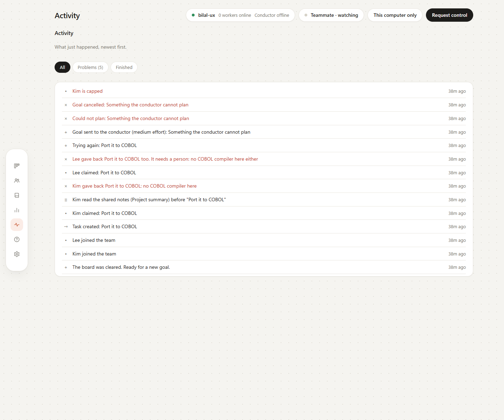

# Dashboard tour

Tandem has seven focused dashboard pages. The point is to keep one job in one place: active work on the Board, people on Team, history in Activity, and commands in Help.

| Page | Use it for |
|---|---|
| Board | Send goals and follow active work |
| Team | See workers and add a teammate |
| Shared memory | Maintain notes, agents, and live locks |
| Usage | Compare tokens or estimated dollars |
| Activity | Review completed goals and merge their branch |
| Help | Copy commands and check options |
| Settings | Theme, usage display, and manual work |

## Board — active work at a glance

Every goal receives a lane. Its tasks move from **Waiting** to **To do**, **In progress**, and **Done**. Cards name the files and worker, so the team can immediately see what is running and what is blocked.

Finished goals leave the Board so it stays calm. Their result moves to **Activity**.

## Task details — why this task exists

Open a card to see its assigned worker, locked files, model and effort, dependencies, the reason it was planned, and the task timeline. This is the fastest way to answer “what is that agent doing?”

## Team — the people and computers doing the work

Worker cards show who is online, what they have completed, and which computer they belong to. The lower part of the page contains the exact next step for adding a teammate.

## Shared memory — information every worker needs

The project summary, interfaces, and decisions are the shared notes that go into every task prompt. This page also shows which agent read them, which files are locked now, and the live shared values behind the team.

## Usage — tokens or estimated cost

Switch between tokens and estimated API-price dollars. Usage is grouped by worker and by goal; unavailable quota information is shown plainly instead of as an empty meter.

## Activity — finished work and its history

**Activity** is where finished goals live. It keeps the tested branch, result, files, workers, duration, usage, and **Merge into my project** together, followed by the plain-language event log.

## Help and Settings — commands, preferences, and manual work

The dashboard’s **Help** page is for quick copy-and-run commands. The longer [Help & troubleshooting guide](HELP.md) is easier to scan on GitHub and includes fixes for common setup issues.

**Settings** remembers a System, Light, or Dark theme for the browser. It also carries the usage display preference and tools for adding work by hand.

These screenshots use the dashboard’s automated sample team. Simulated workers are labelled as such; the interface and coordination flow are the same as a live team.
